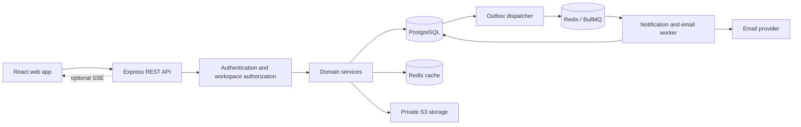
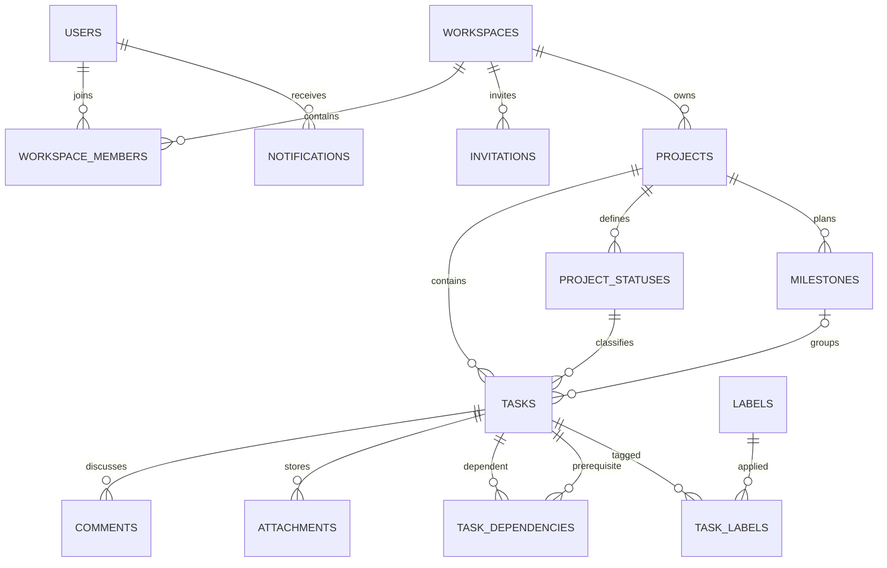

# Project management app — product and system blueprint

Proposed design · October 19, 2026. Companion: [Implementation plan](implementation-plan.md).

## 1. Product contract

For small teams that need to assign, discuss, and track project work. Core hierarchy: User → Workspace membership → Project → Task. A workspace is the security boundary. In the first release, all workspace members can see all its projects; private projects are deferred.

Roles:

- **Owner:** manage workspace, invitations, membership, roles, ownership transfer, and all content. Moderate comments and delete/archive projects.
- **Editor:** create projects; create/edit/delete tasks, labels, statuses, milestones, and dependencies; comment and upload attachments. Cannot manage members or delete/archive projects.
- **Viewer:** read projects, tasks, comments, activity, attachments, and reports. Can update their own profile, notification preferences, and inbox read state.
- Users may edit/delete their own comments; owners may moderate any comment. Historical system activity cannot be edited through the API.

Every object lookup checks workspace membership; every mutation checks role. Resource IDs are never proof of access. Return 404 for resources outside accessible workspaces, 403 for disallowed actions inside an accessible workspace. User profile endpoints operate on the authenticated user.

## 2. Screens and navigation

```text
Login / Register / Accept invitation
└── Workspace switcher
    ├── Overview: overdue work, assigned work, upcoming milestones
    ├── My Tasks: tasks assigned to me in the current workspace
    ├── Projects
    │   └── Project
    │       ├── Board / List
    │       ├── Task detail: fields, subtasks, dependencies, comments, history
    │       ├── Milestones
    │       ├── Activity
    │       └── Reports
    ├── Notification inbox
    └── Settings: members, invitations, workspace, my preferences
```

Task detail uses one URL so a task can be linked from emails and notifications. Board/list share filters. Board drag-and-drop uses optimistic updates, with rollback on rejection. Expose task-moving controls that also work without dragging. Design the actual screens before implementation; this blueprint defines their purpose and behavior, not final styling.

## 3. System architecture

Use a modular monolith. Keep PostgreSQL as the source of truth. Run API and worker separately from the same codebase.



Redis caching can fail open to PostgreSQL; queue processing pauses and retries during Redis outages. Use separate Redis deployments for production cache and jobs when possible: cache eviction and queue durability have different requirements. Local development can share one instance with explicitly documented settings.

Suggested code structure:

```text
src/
  app.ts                     # middleware and routes; exports app
  server.ts                  # startup and shutdown
  config/                    # validated environment, database, Redis
  modules/
    auth/
    workspaces/
    projects/
    tasks/
    comments/
    notifications/
    reports/
  middleware/                # authentication, authorization, errors
  jobs/                      # dispatcher, workers, reminder scheduling
  shared/                    # errors, pagination, logging
migrations/
tests/integration/
web/                         # frontend
```

Each module has routes, validators, controllers, services, and database queries as needed. Controllers translate HTTP; services enforce business rules and transaction boundaries. Move existing controllers incrementally when touching them.

## 4. Logical database model

Adapt types and migration syntax to the actual existing schema. All entities use created_at; mutable content also uses updated_at. Store timestamps with time zone and exchange ISO 8601 UTC values.

- **users:** id, name, email (unique normalized), password_hash, profile_image_key, timezone.
- **workspaces:** id, name, created_by. Ownership lives in membership roles rather than a second competing owner field.
- **workspace_members:** workspace_id, user_id, role; unique pair. Exactly one owner for the initial product; transfer ownership atomically under a workspace lock.
- **invitations:** id, workspace_id, email, role (editor/viewer), token_hash (unique), expires_at, accepted_at, revoked_at, invited_by. Acceptance locks the invitation and checks expiry, revocation, and account email.
- **projects:** id, workspace_id, name, description, archived_at, created_by.
- **project_statuses:** id, project_id, name, position, is_done. Seed Backlog, In Progress, Review, Done. Referenced statuses cannot be deleted without moving their tasks.
- **tasks:** id, project_id, title, description, status_id, priority, assignee_id nullable, due_at nullable, parent_task_id nullable, milestone_id nullable, position, version, created_by.
- **labels:** id, project_id, name; unique project/name.
- **task_labels:** task_id, label_id; unique pair.
- **milestones:** id, project_id, title, description, due_at nullable.
- **task_dependencies:** task_id, prerequisite_task_id; unique pair; task cannot equal prerequisite. Both belong to the same project.
- **comments:** id, task_id, author_id, body, edited_at nullable, deleted_at nullable. Store plain text initially.
- **comment_mentions:** comment_id, user_id; unique pair; mentioned users must be workspace members.
- **attachments:** id, task_id, uploaded_by, object_key, original_name, media_type, size_bytes. Private S3 objects; downloads require authorization and short-lived signed links.
- **activity_events:** id, workspace_id, project_id, task_id nullable, actor_id nullable, event_type, before/after JSON, created_at. Preserve entity labels for deleted-task history; apply a deliberate retention policy.
- **notifications:** id, recipient_id, workspace_id, event_id, type, payload, read_at nullable; unique recipient/event/type.
- **notification_preferences:** user_id, event_type, in_app_enabled, email_enabled; unique user/event pair.
- **outbox_events:** id, event_type, payload, created_at, dispatched_at nullable, attempts. Written in the same transaction as domain changes.
- **notification_deliveries:** id, event_id, recipient_id, channel, state, provider_id nullable; unique event/recipient/channel. Tracks delivery attempts and deduplication.

Use foreign keys and composite references where practical to ensure a task's status, parent, milestone, and labels belong to its project. Services validate assignees against workspace membership. Membership removal clears open assignments transactionally and cancels pending access-dependent deliveries. Retain attribution for historical activity.

Initial indexes: projects(workspace_id, created_at, id); tasks(project_id, status_id, position, id); tasks(assignee_id, due_at, id); comments(task_id, created_at, id); activity_events(project_id, created_at, id); notifications(recipient_id, created_at, id); an index for undispatched outbox events. Add search indexes only after validating query plans.



## 5. API resource map

All routes below have prefix `/api/v1`. This is a proposed contract, not a list of implemented endpoints. Define request/response schemas in OpenAPI alongside implementation.

### Identity

```text
POST   /auth/register
POST   /auth/login
GET    /me
PATCH  /me
```

Keep short-lived JWT authentication initially. If persistent sessions are added, design refresh-token rotation and server-side revocation explicitly. Do not imply that deleting a browser token invalidates an issued JWT. Prefer keeping access tokens in memory; cookie-based authentication requires a deliberate CSRF design.

### Workspace membership

```text
GET, POST     /workspaces
GET, PATCH    /workspaces/:wid
GET           /workspaces/:wid/members
PATCH, DELETE /workspaces/:wid/members/:uid
POST          /workspaces/:wid/ownership-transfer
GET, POST     /workspaces/:wid/invitations
DELETE        /workspaces/:wid/invitations/:iid
POST          /invitations/accept
```

Accept an invitation token in the request body. A member cannot change their own role to owner. Ownership transfer is the only owner-reassignment path.

### Projects and tasks

```text
GET, POST          /workspaces/:wid/projects
GET, PATCH, DELETE /workspaces/:wid/projects/:pid
GET, POST          /workspaces/:wid/projects/:pid/statuses
PATCH, DELETE      /workspaces/:wid/projects/:pid/statuses/:sid
GET, POST          /workspaces/:wid/projects/:pid/tasks
GET, PATCH, DELETE /workspaces/:wid/projects/:pid/tasks/:tid
GET                /workspaces/:wid/my-tasks
GET, POST          /workspaces/:wid/projects/:pid/labels
PATCH, DELETE      /workspaces/:wid/projects/:pid/labels/:lid
```

PATCH task handles title, description, status, priority, assignee, deadline, position, parent, milestone, and label IDs. Include `version`; a stale write returns 409. Clear nullable fields using explicit null. Validate allowed fields to prevent mass assignment. Start with one assignee per task and one level of subtasks. Project deletion requires owner authority and a deliberate policy for cascading database records and queued S3 cleanup; archiving is the normal UI action.

Task list query: `?statusId=...&assigneeId=...&priority=high&labelId=...&overdue=true&q=...&sort=due_at&limit=25&cursor=...`. Whitelist sorts, use a stable ID tiebreaker, cap limit at 100, and bind cursors to the chosen sort/filter combination.

### Collaboration and files

For brevity, `TASK` means `/workspaces/:wid/projects/:pid/tasks/:tid`.

```text
GET, POST     TASK/comments
PATCH, DELETE TASK/comments/:cid
GET, POST     TASK/attachments
GET, DELETE   TASK/attachments/:aid
GET           /workspaces/:wid/projects/:pid/activity
```

Attachment POST accepts bounded multipart uploads; attachment GET by ID returns an authorized short-lived download URL. Store files privately and clean up abandoned uploads. Mention IDs are structured fields validated against workspace membership, not blindly parsed email addresses.

### Scheduling and reporting

```text
GET, POST          TASK/dependencies
DELETE             TASK/dependencies/:prerequisiteId
GET, POST          /workspaces/:wid/projects/:pid/milestones
GET, PATCH, DELETE /workspaces/:wid/projects/:pid/milestones/:mid
GET                /workspaces/:wid/projects/:pid/reports/summary
```

Dependency edge meaning: `task depends on prerequisite`. Serialize dependency insertions per project (for example, lock the project row inside the transaction) and check the graph for cycles before inserting. Completion checks lock the same project while validating prerequisites so concurrent graph/status writes cannot violate the rule. Reopen flags are derived from the current graph and statuses.

### Notifications and operations

```text
GET           /me/notifications
PATCH         /me/notifications/:nid
GET, PATCH    /me/notification-preferences
GET           /workspaces/:wid/events             # optional SSE
GET           /health/live
GET           /health/ready
```

Read-state changes only affect the current user's notifications. Health routes sit outside `/api/v1` in the deployment if desired. Liveness checks process health; readiness checks dependencies needed to serve requests. A cache outage alone should not make a database-backed API unready. Monitor worker readiness independently.

### Response conventions

Single resource: `{ "data": { ... } }`. List: `{ "data": [...], "page": { "nextCursor": null } }`. Error: `{ "error": { "code": "TASK_BLOCKED", "message": "Complete prerequisites first", "requestId": "...", "details": {} } }`.

Use 201 for creation, 200 for reads/updates, 204 for deletion, 400 for malformed requests, 401 for missing/invalid authentication, 403 for forbidden actions, 404 for absent/inaccessible objects, 409 for version or business conflicts, 422 for invalid fields, and 429 for rate limits. Never return stack traces or password fields.

## 6. Critical write flows

**Assign task:** authenticate → verify editor membership → lock/version-check task → verify assignee membership → update task + activity + outbox in one PostgreSQL transaction → commit → dispatcher enqueues → worker creates recipient notification and sends email subject to preferences. Workers recheck membership. Authorize before returning any cached result.

**Outbox dispatch:** claim batches safely across dispatchers; enqueue using a stable event/job ID; mark dispatched only after enqueue succeeds. Delivery remains at least once. Database uniqueness and delivery state absorb retries; a provider idempotency key is needed to close the crash-after-send duplicate-email window where supported.

**Move on board:** send status, position, and expected version → validate all project references → apply atomically → return new version. Use spaced integer positions initially; rebalance a column under a lock when gaps run out. Stale moves return 409 and prompt a refetch.

**Cache summary:** verify live membership → read workspace/project-scoped key → on miss query database and cache briefly. Invalidate after commits; use a generation/versioned key to avoid an old in-flight query repopulating the active key. TTL bounds stale data when invalidation fails. Task mutations affecting reports advance the generation. Start with summaries rather than arbitrarily caching every filter combination.

## 7. Reporting definitions

- Completion: top-level tasks in statuses marked is_done divided by all non-deleted top-level tasks; empty project displays “No tasks,” without a misleading completion percentage.
- Overdue: incomplete task with due_at earlier than the evaluation time.
- Blocked: incomplete task with at least one incomplete prerequisite.
- Workload: open top-level task count per assignee plus unassigned; label this as task count, not effort or productivity.
- Milestone completion: completed top-level tasks assigned to the milestone divided by all its non-deleted top-level tasks.

Reports state their timezone and evaluation time. Subtasks appear in detail views; exclude them from headline totals to avoid counting the same work twice. Project search initially uses bounded PostgreSQL queries; a separate search service is unnecessary for the first release.

## 8. Migration from this codebase

1. Back up and inspect the actual schema. Establish a migration baseline matching it.
2. Add new workspace tables and nullable project.workspace_id. Create a personal workspace and owner membership per existing project owner; backfill projects; verify no missing workspace references; then enforce non-null and foreign keys.
3. Preserve project creator attribution. Replace authorization based on projects.user_id with workspace membership checks, route by route. Remove obsolete ownership fields only after verification.
4. Add project statuses; map existing task statuses explicitly after inspecting actual distinct values. Add task version, assignment, priority, and scheduling fields.
5. Introduce `/api/v1` and migrate the frontend/client. Keep old routes temporarily only if required, protected by the same new authorization rules; remove them through a documented cutover.
6. Correct misspelled source folders when moving modules, and regenerate build output rather than editing dist files.

## 9. Verification and delivery evidence

Required scenarios: cross-workspace read/write rejection; viewer write rejection; concurrent invitation acceptance; last-owner protection; removed-member assignment cleanup; cycle prevention under concurrency; stale task edit rejection; comment moderation; outbox recovery; reminder rescheduling; cache invalidation; upload access checks; stream revocation if implemented.

Deliver a README, runnable demo seeds, OpenAPI contract, versioned migrations, integration/end-to-end test results, deployment guide, restore procedure, and benchmark methodology with measured results. A polished demo of the full collaboration workflow is the release criterion; endpoint count is not.
