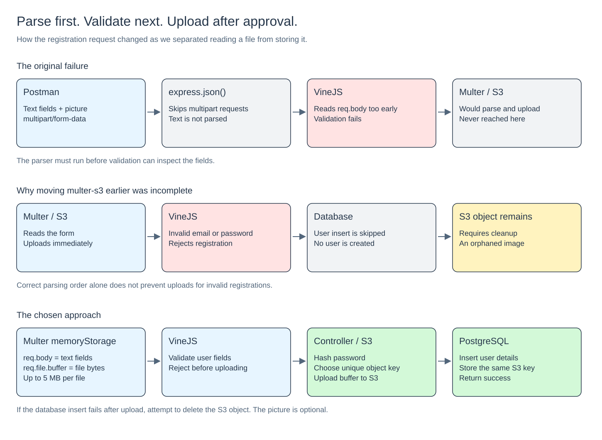
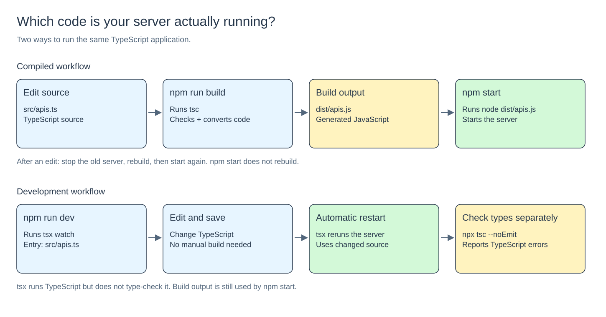

# Why my Express registration worked with JSON—and failed with a profile picture

*A junior developer’s guide to Multer, VineJS, S3 keys, and running the code you actually edited.*

Adding a profile picture sounded like a small change: receive an image, upload it to S3, and save its key with the user. But it exposed three separate things I needed to understand: how Express reads request bodies, when an upload actually happens, and which version of my application Node is running.

This article follows the problems we found in an Express + TypeScript application using PostgreSQL, VineJS, and AWS S3. The examples use an optional `profilePic` field. The core lesson is simple:

> Read the request first. Validate its fields. Then perform the upload and database insert.

## 1. A tutorial’s configuration needs to fit your project

The tutorial used CommonJS, while this project already had `"type": "module"` in `package.json` and imports ending in `.ts`.

Copying its `tsconfig.json` unchanged introduced two problems: the generated module format would conflict with the project’s ES module setup, and the compiler would reject the existing `.ts` import paths. The proposed config produced 27 import errors when checked.

The compatible configuration was:

```json
{
  "compilerOptions": {
    "target": "ES2020",
    "module": "NodeNext",
    "outDir": "dist",
    "rootDir": "src",
    "strict": true,
    "esModuleInterop": true,
    "skipLibCheck": true,
    "rewriteRelativeImportExtensions": true
  },
  "include": ["src/**/*"]
}
```

`NodeNext` fits the project’s Node module setup. `rewriteRelativeImportExtensions` changes relative `.ts` imports into `.js` imports in the compiled output. Removing the previous `noEmit: true` allows that output to be generated.

The tutorial also created an `index.ts` file without showing the server implementation in it. This application already started its server in `apis.ts`. The startup command therefore needed to point to that file’s compiled output: `dist/apis.js`.

**Lesson:** a filename such as `index.ts` is not mandatory. Your startup command must point to the file that actually starts your application.

## 2. JSON and multipart forms need different parsers

A JSON registration request might contain:

```json
{
  "name": "Ahmad Test",
  "email": "ahmad@example.com",
  "password": "example-password"
}
```

With `Content-Type: application/json`, this middleware reads it:

```ts
bull.use(express.json());
```

Afterward, the fields are available in `req.body`.

A request containing a picture normally uses `multipart/form-data`. One body can contain both text fields and a file; you do not need to send a separate JSON body.

For this registration request, Postman’s form-data entries are:

- `name` — Text
- `email` — Text
- `password` — Text
- `profilePic` — File

`express.json()` does not parse this format. Multer can read it, putting text fields in `req.body` and the uploaded file in `req.file`.

### The original execution order

The route originally ran:

```ts
bull.post(
  "/users",
  validate(createUserValidator, messageProvider),
  upload.single("profile-pic"),
  createUser
);
```

Express executes those functions from left to right. VineJS tried to validate the multipart fields before Multer had read them. The error was not evidence that VineJS could not handle form fields; it was receiving the request too early.



[Edit this diagram in Excalidraw](registration-flow.excalidraw)

## 3. A form field name is not a filename

This line:

```ts
upload.single("profilePic")
```

means “accept one uploaded file under the form field named `profilePic`.”

It does not name the file in S3.

Three names have different jobs:

- **Form field name:** `profilePic` — identifies the upload in the request.
- **Original filename:** `Daredevil.jpg` — the filename supplied by the client.
- **S3 key:** `uploads/random-id-Daredevil.jpg` — the object’s name inside the bucket.

Sending `profilePic` when the route expects `profile-pic` causes an unexpected-file error. Sending more than one file to `.single()` can also cause it.

A dynamic form field name is possible, but registration has a known purpose. A fixed name such as `profilePic` is simpler to document and test.

## 4. Why moving Multer earlier was only part of the solution

The first idea was to run Multer before VineJS. That makes the text fields available, but the existing middleware used `multer-s3` as its storage.

With that setup, Multer reads the form **and uploads the image to S3** before the next middleware runs.

That creates this failure path:

```text
Upload image → Reject invalid user fields → No user is created
```

The image remains in S3 with no user referencing it. We called this an **orphaned image**.

The better fit for this small profile-picture upload was to separate parsing from uploading.

## 5. What memoryStorage() actually does

Multer’s `memoryStorage()` temporarily holds the uploaded bytes in server RAM. It does not upload to S3 or save a local file.

```ts
// src/middleware/parse-profile.ts
import multer from "multer";

const parseProfile = multer({
  storage: multer.memoryStorage(),
  limits: {
    fileSize: 5 * 1024 * 1024,
  },
});

export default parseProfile;
```

The limit is 5,242,880 bytes, commonly described here as a 5 MB limit. Each simultaneous upload consumes memory, so a per-file limit matters. It is not a total limit for the whole server.

After parsing, a file has properties such as:

```ts
req.file?.originalname // "photo.jpg"
req.file?.mimetype     // "image/jpeg"
req.file?.size         // Number of bytes
req.file?.buffer       // The actual file bytes in memory
```

A **buffer** is simply a way of holding those bytes. It is the data we later send to S3.

At this point there is no S3 key on the file, because it has not been stored there. The relevant TypeScript interface is `Express.Multer.File`, rather than the `Express.MulterS3.File` used for files already handled by multer-s3.

When the request is finished and nothing retains the buffer, its memory can be reclaimed. It is not permanent storage.

## 6. Three route functions, three responsibilities

The registration route becomes:

```ts
bull.post(
  "/users",
  parseProfile.single("profilePic"),
  validate(createUserValidator, messageProvider),
  createUser
);
```

The first function reads the multipart form. The second checks the registration fields. The third handles password hashing, S3 uploading, and database insertion.

Middleware passes control along by calling `next()`. It is the same request moving through the sequence; Multer has added the fields and file to it.

The existing VineJS middleware keeps the validated output here:

```ts
const output = await validator.validate(req.body, {
  messagesProvider: messageProvider,
});

res.locals.validatedData = output;
next();
```

`res.locals` is temporary storage for this request. It does not write anything to PostgreSQL. The controller reads those validated values:

```ts
const { name, email, password } = res.locals.validatedData;
```

The project’s schema requires a trimmed name of at least five characters, a valid email, and a password of at least eight characters. A correctly parsed form can still fail those rules. The response’s `errors` array is the useful clue.

JSON registration still works: `express.json()` reads the JSON body, Multer skips the non-multipart request, and the controller handles the absence of `req.file`.

## 7. Which line actually uploads the image?

This line does **not** upload a file:

```ts
const file = req.file as Express.MulterS3.File;
```

`as` tells TypeScript how to treat a value. It does not create a file, verify its shape, or make an AWS request.

In the original multer-s3 approach, the upload had already happened inside the upload middleware.

With memory storage, the controller explicitly uploads the buffer:

```ts
const result = await s3.send(new PutObjectCommand({
  Bucket: bucket,
  Key: key,
  Body: req.file.buffer,
  ContentType: req.file.mimetype,
}));
```

`PutObjectCommand` describes the upload. `s3.send(...)` performs it. `await` waits for its result before continuing.

The result contains upload information such as an ETag and response metadata. It does not return the object’s key or a ready-to-use public URL. If the operation fails, it throws an error.

## 8. You choose the key before uploading

An S3 key is the object’s name inside its bucket:

```ts
let key: string | null = null;

const filename = req.file.originalname.replace(
  /[^a-zA-Z0-9._-]/g,
  "_"
);

key = `uploads/${randomUUID()}-${filename}`;
```

The replacement makes the filename more predictable. The random ID prevents two pictures with the same original name from overwriting one another. The `uploads/` prefix appears like a folder in the S3 console.

Use **the same `key` variable** for the upload and database insert:

```ts
// Upload the picture using this name.
await s3.send(new PutObjectCommand({
  Bucket: bucket,
  Key: key,
  Body: req.file.buffer,
  ContentType: req.file.mimetype,
}));

// Associate that name with the new user.
await pool.query(
  `INSERT INTO users (name, email, password, profile_pic_key)
   VALUES ($1, $2, $3, $4)
   RETURNING id`,
  [name, email, hashedPassword, key]
);
```

The database stores the reference, not the image bytes. A later request can use the key to find the image in S3.

### The variable mistake that silently lost the key

Inside the upload block, the code initially used:

```ts
let key: string | null = null;

if (req.file) {
  const key = "uploads/some-image.jpg";
}
```

These are two different variables. The inner `const key` does not update the outer one. The database receives `null`, and cleanup also sees `null`.

The fix is assignment without another declaration:

```ts
if (req.file) {
  key = "uploads/some-image.jpg";
}
```

**Lesson:** use `const` or `let` to declare a variable; use `=` by itself to update an existing variable.

## 9. A compact reference controller

This example assumes the route has already parsed the form and validated the fields. It uses the existing S3 client and database pool. Image-type checks are discussed below; the parser above only enforces size.

```ts
import type { Request, Response } from "express";
import bcrypt from "bcryptjs";
import { randomUUID } from "node:crypto";
import { PutObjectCommand, DeleteObjectCommand } from "@aws-sdk/client-s3";
import pool from "../pool/pooler.ts";
import s3 from "../S3/s3.ts";

const createUser = async (req: Request, res: Response) => {
  const { name, email, password } = res.locals.validatedData;
  const hashedPassword = await bcrypt.hash(password, 8);
  const bucket = process.env.AWS_BUCKET_NAME;

  let key: string | null = null;
  let createdUserId: number;

  try {
    if (req.file) {
      if (!bucket) throw new Error("AWS_BUCKET_NAME is missing");

      const filename = req.file.originalname.replace(
        /[^a-zA-Z0-9._-]/g,
        "_"
      );
      key = `uploads/${randomUUID()}-${filename}`;

      await s3.send(new PutObjectCommand({
        Bucket: bucket,
        Key: key,
        Body: req.file.buffer,
        ContentType: req.file.mimetype,
      }));
    }

    const results = await pool.query(
      `INSERT INTO users (name, email, password, profile_pic_key)
       VALUES ($1, $2, $3, $4)
       RETURNING id`,
      [name, email, hashedPassword, key]
    );

    createdUserId = results.rows[0].id;
  } catch (error) {
    if (key && bucket) {
      try {
        await s3.send(new DeleteObjectCommand({
          Bucket: bucket,
          Key: key,
        }));
      } catch {
        console.error("Image cleanup failed for key:", key);
      }
    }
    throw error;
  }

  res.status(201).json({
    message: "User created successfully",
    id: createdUserId,
  });
};

export { createUser };
```

The password is hashed before insertion. If there is no picture, `key` remains `null`; the existing `profile_pic_key` database column was confirmed to allow `NULL`.

The response is outside the upload-and-insert `try/catch`. That keeps a response error from triggering image deletion after a successful insert. `createdUserId` is a regular variable used to carry the ID outside that block. It could also be held in `res.locals`, but that is unnecessary here.

### What cleanup can and cannot guarantee

If validation fails, no upload has happened. If the database insert fails after an upload, deletion is attempted. Deletion is also attempted after an upload error because S3 might have received the object even if its response was lost.

Deletion can fail too—for example, because of permissions or a network problem. Logging the key makes manual cleanup possible. This small approach cannot guarantee cleanup after a server crash or every uncertain network outcome. PostgreSQL and S3 do not automatically undo each other’s work.

For this app, it is a useful, understandable approach. Larger systems may need a separate cleanup process.

## 10. A private image URL does not grant access

The earlier successful upload returned a key and a URL. That proved the upload handler reported success; it did not make the bucket public.

Keep the key in the database. When you later need to show a private image, the backend can generate a temporary presigned URL. Do not store that temporary URL as the permanent reference—it expires.

## 11. The code looked fixed, but the server still ran the old route

We inspected the TypeScript route and found the parser correctly placed before validation. But the generated `dist/apis.js` still contained the old order.

This was a separate issue from multipart parsing: the server could be running yesterday’s compiled code.



[Edit this diagram in Excalidraw](build-and-development.excalidraw)

In this project:

```bash
npm run build
```

runs `tsc`: it checks TypeScript and generates JavaScript in `dist`.

```bash
npm start
```

runs `node dist/apis.js`. It does not rebuild the source first. Stop the running server, rebuild successfully, and start it again after source edits when using this workflow.

During diagnosis, TypeScript also reported an unused older middleware importing an `AppError` that was not exported. Files included by `tsconfig.json` can cause build errors even when the active route does not import them. Resolve compiler errors rather than assuming a new build succeeded.

### A simpler development loop

The project now has `tsx` installed and this script:

```json
{
  "scripts": {
    "dev": "tsx watch src/apis.ts",
    "build": "tsc",
    "start": "node dist/apis.js"
  }
}
```

Run:

```bash
npm run dev
```

Save a source change and `tsx watch` restarts the server automatically. It runs TypeScript without writing a new `dist` build.

It does not type-check the application. Run this separately:

```bash
npx tsc --noEmit
```

You still need a fresh build when switching back to `npm start`.

## 12. How to test without guessing

In Postman, send `POST http://localhost:4000/users`, or use the port configured for your server. The current registration route is public and appears before the global authentication middleware.

Choose **Body → form-data**. Add `name`, `email`, and `password` as Text entries. Add `profilePic` as a File entry and select one picture. Do not manually set the `Content-Type` header: Postman supplies it with the boundary needed to separate the form’s parts.

Try these cases:

1. Valid fields and a picture: expect a user with an S3 key in `profile_pic_key`.
2. Valid fields without a picture: expect a user with a `NULL` picture key.
3. Invalid email or short password: expect validation failure before S3 upload.
4. Wrong file field name: expect Multer to reject it.
5. File larger than the limit: expect rejection before controller execution.
6. Database failure after upload, tested with fakes: verify deletion is attempted.

When something fails, identify which stage produced the error. Read the response’s field-level validation details. Check the terminal for upload or database errors. Confirm that the running process uses your current source or a fresh build. Avoid logging passwords or AWS credentials while debugging.

## 13. What was verified, and what remains

During the discussion, a more complete implementation with image checks and tests was added, then reverted at your request so you could build the simpler approach yourself. Its earlier passing test results do not certify the current manual implementation.

At the time this article was prepared:

- The current route uses memory parsing before VineJS validation.
- The controller explicitly uploads the buffer and assigns the outer `key` variable correctly.
- `tsx watch src/apis.ts` is configured and installed.
- The current TypeScript check passes.
- No new live registration or S3 upload was performed for this article.
- `npm test` is currently the original placeholder, not the earlier test suite.

The current parser limits size but does **not** restrict uploads to real images. `mimetype` is supplied by the client; naming a file `.jpg` does not make it an image. Add supported-type and content checks before upload. A signature check helps identify formats but is not a complete image safety check.

The current generic error handler also does not yet give Multer size and field errors specific client-facing responses. Finally, the current controller still sends its success response inside the cleanup `try/catch`; the reference example above shows the cleaner separation. These are follow-up improvements, not changes made by this article.

## A note to my future self

Before rearranging middleware, ask what each function needs and what it changes. A validator needs parsed fields. An S3 upload creates a persistent object. A database insert creates a separate record. Their order matters because a later step can fail after an earlier one succeeds.

Keep these distinctions clear:

- Parsing is not uploading.
- A form field name is not a filename or S3 key.
- A TypeScript assertion does not perform a runtime action.
- The upload and database insert must use the same key.
- Optional files require an explicit absence check.
- Saving source code does not refresh a compiled server.

Those distinctions explain nearly every confusing error we encountered—and make the next upload feature much easier to reason about.
